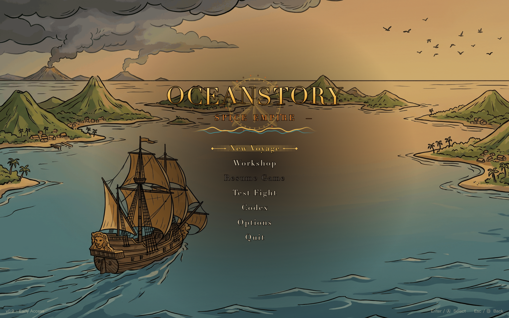
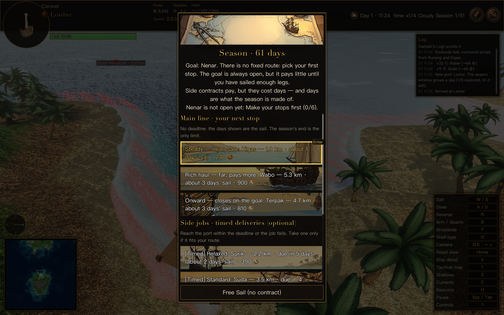
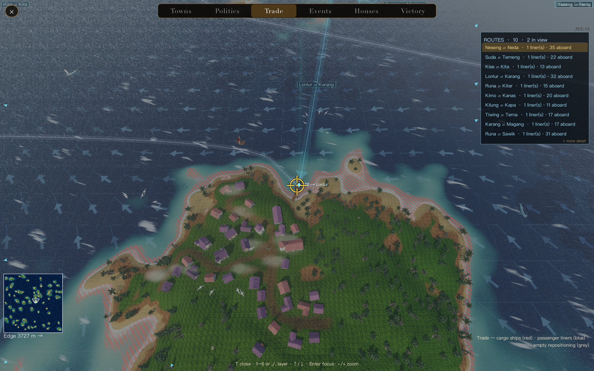
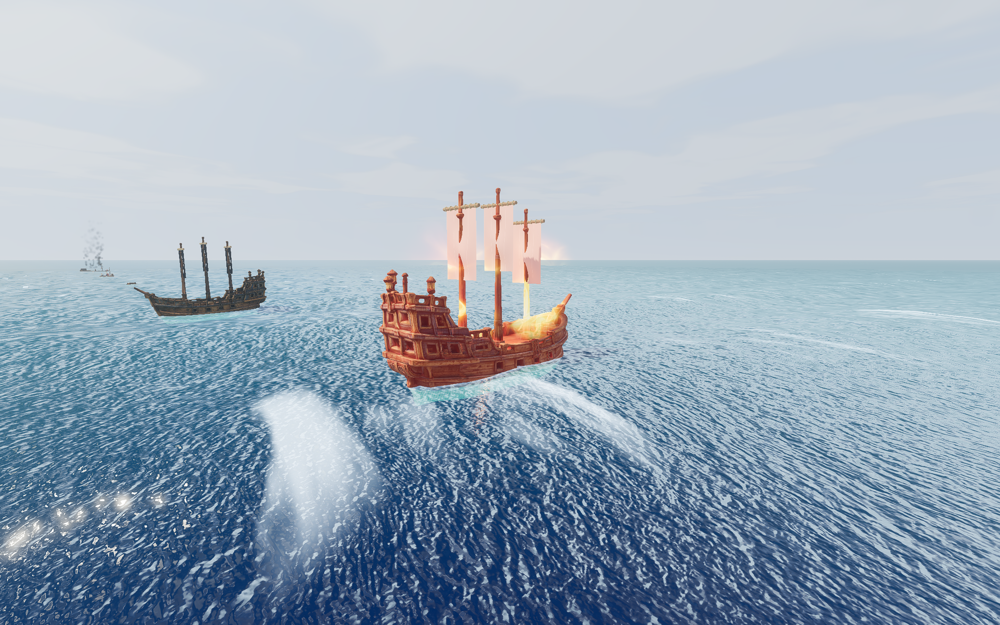
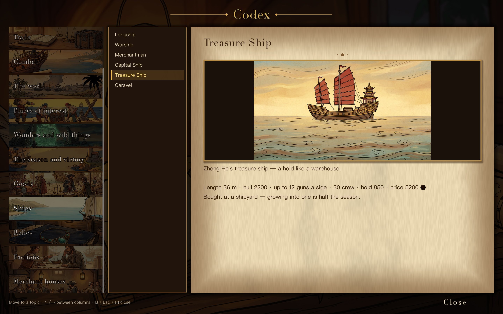
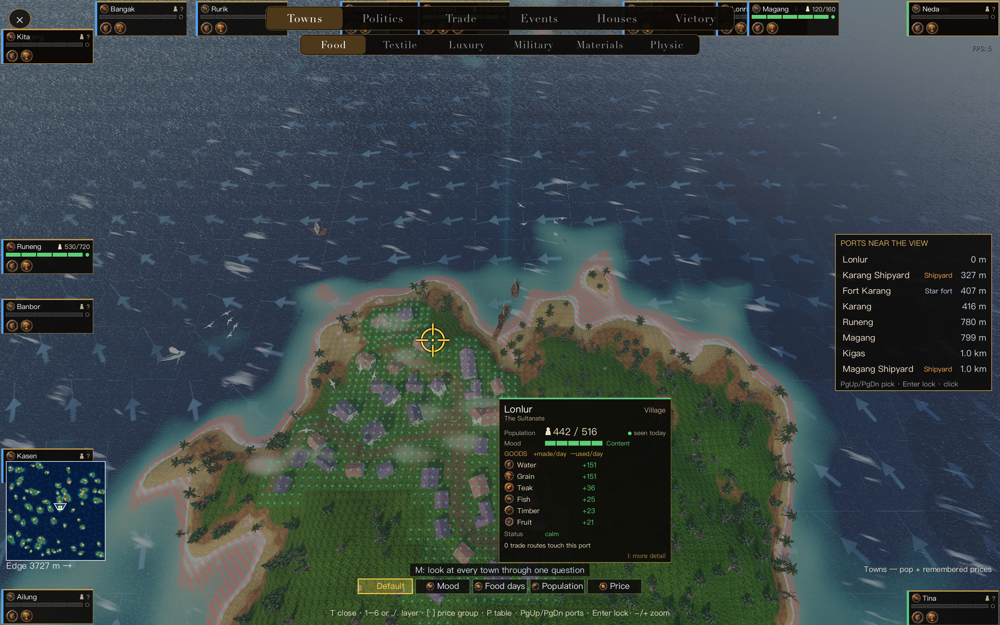
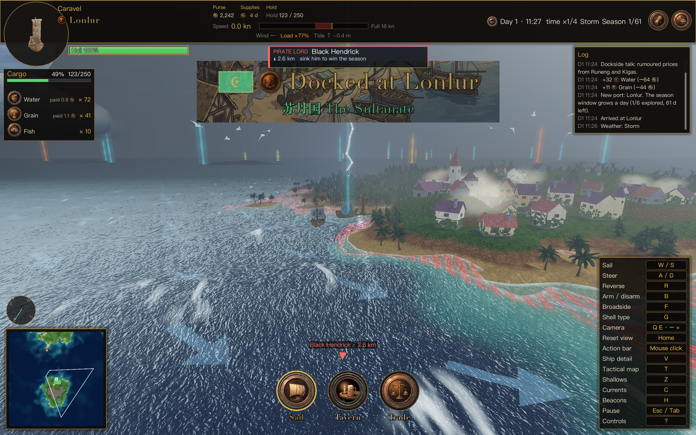
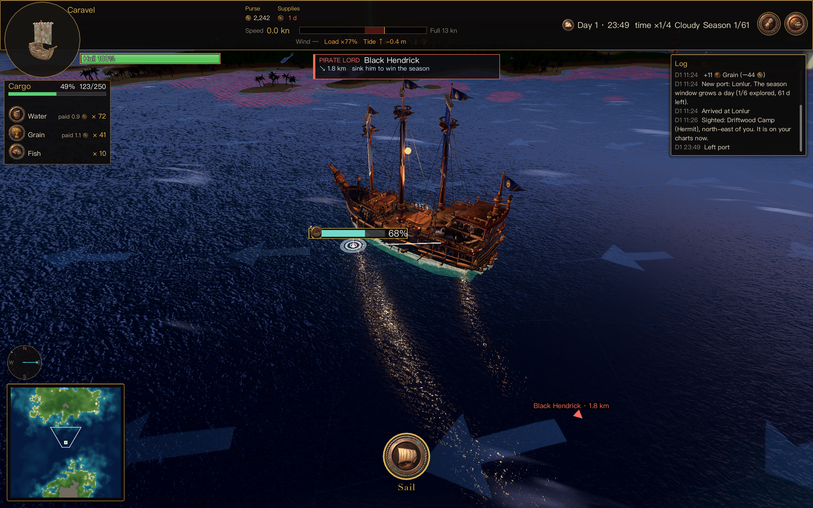
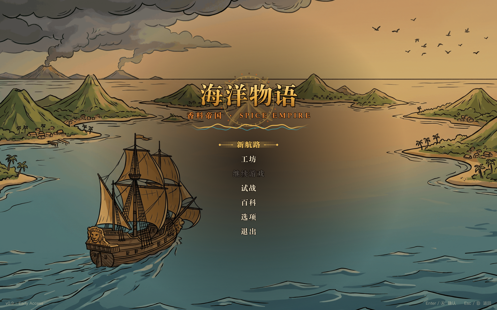

# Oceanstory · Spice Empire — Support, Privacy & Marketing

A sailing roguelike in the 17th-century Spice Islands: read the prices, pick the port, beat the monsoon. The archipelago keeps trading while you sail.

**This repository is not the game.** It is the public web presence for Oceanstory: the marketing page, the privacy policy, and the place to report problems. The game itself is closed source and is not part of this repository.

---

## Pages

| | |
|---|---|
| **Marketing page** | <https://chanliu1983.github.io/oceanstory-site/> |
| **Privacy policy** | <https://chanliu1983.github.io/oceanstory-site/privacy.html> |
| **Support page** | <https://chanliu1983.github.io/oceanstory-site/support.html> |

All three are single static files with an in-page English / 中文 toggle. No cookies, no trackers, no external requests, no fonts pulled from anywhere.

---

## Reporting a problem

**Open an issue:** <https://github.com/chanliu1983/oceanstory-site/issues/new>

**You may submit issues in either English or Chinese / 您可以使用中文或者英文提交反馈**

There is no language switch on GitHub Issues, and there does not need to be one — write whichever language is easier. Every issue is read.

GitHub also lets you write an issue in the interface of your choice from the "…" menu, but plain English or plain Chinese text is perfectly fine and is usually faster.

### What to include

The more of this you give, the faster the answer:

1. **Version** — the bottom-right corner of the main menu.
2. **Platform** — macOS version, or Windows version.
3. **What you did**, and **what happened instead**.
4. **A screenshot or a short screen recording**, if it is a visual problem.
5. **The seed**, if you can find it — the world is generated from it, and the same seed reproduces the same map. It is shown in the world menu.

### Before you file it

A few things that look like bugs but are the rules working:

- **A new voyage retires the run you were playing, not the other nine.** Progress belongs to the map that was played, so the run you are in is over when you start a new one — but the other nine slots are still there, each on its own map. The campaign progress across runs (`season_meta.json`) is kept.
- **A port can close.** If a faction hates you enough, its fort fires and the harbour stops trading. So can a war, a blockade or a shortage of food.
- **Prices you remember are not prices you have.** The world moves while you sail. A price from ten days ago is a question mark on the tactical map; only what you saw recently, or bought as intelligence, is solid.
- **Water is heavier than gold.** A hold full of fresh water is a slow ship, and a slow ship is a ship that runs out of water.

---

## Screenshots

Raw, full-resolution captures live in [`/screenshots`](screenshots) — no text is baked into the pictures. The marketing page uses the same set, re-encoded to JPEG under [`/assets`](assets) so the page stays light.

<!-- prettier-ignore -->
| | |
|---|---|
|  |  |
| The title screen: a painted archipelago, a ship, and the gold name. | Every stop offers a choice — the days at sea, the pay, and the rumours waiting there. |
|  |  |
| The tactical map. Towns, powers, shipping lanes, rumours. | Six hulls under sail. Every one of them eats water and food, every day, at sea. |
|  |  |
| Both sides, one at a time. The gun deck is the only warm place on the ship. | The Codex — thirteen categories, a hundred entries, every one painted. |
|  |  |
| A harbour and its prices. The stock column is the whole game in one table. | A storm over the harbour. The season's pirate king does not wait for you to be ready. |
|  |  |
| Night watch. The stars are out and the sea is on its own. | The same title screen, in Chinese — the marketing page swaps it for the Chinese one. |

The page also runs a **day-cycle strip** — golden hour, sunset, afterglow, blue hour,
night, predawn — cut from the same captures (`assets/day-*.jpg`).

App Store assets live in [`/appstore`](appstore): the ten product-page screenshots in English and Chinese at 2880×1800 — the size Apple wants, which it scales down to the other Mac sizes by itself — plus the 1920×1080 app preview video. The first three shots are the ones Apple shows in search results.

---

## The game in one paragraph

Oceanstory is a sailing roguelike set in the 17th-century Spice Islands, where nutmeg and clove are worth more than gold. A season is one long voyage: a chain of contracts that arrives as a route rather than a list, so every port offers two or three ways on, each with its own days at sea, its own pay and its own rumours. The monsoon window is thirty days, sixty or ninety, and when it closes the season ends with whatever you are holding. The archipelago is alive while you are at sea — people eat, leave and arrive, prices follow them, powers go to war over harbours and blockade the roads you meant to use, and twelve merchant hulls arbitrage the difference between two islands without asking you. Win by any one of five checklists: sink the pirate king and deliver his treasure, grow a trade empire, make a diplomatic alliance, walk the old places' secrets, or own three spice plantations and feed the ports. Six hulls from a twelve-metre caravel to a ship of the line, broadside guns loaded separately down each side, three kinds of shot, and a hold that carries your provisions — so the way you fill it decides how fast you sail and how long you last. English and Chinese, keyboard and gamepad. And the archipelago keeps evolving: the harbours you emptied, the prices you broke and the ports you closed are all still there, waiting for the next season.

© 2026 Lei Liu. All rights reserved.

---

# 海洋物语 · 香料帝国 —— 支持、隐私与官网

17 世纪香料群岛上的航海 Roguelike：读数字，择港口，赶季风。你不盯着这片海的时候，它还在做生意。

**这个仓库不是游戏本体。** 它是《海洋物语 · 香料帝国》的公开网页门面：官网、隐私政策，以及提交问题的地方。游戏本体不开源，也不包含在这个仓库里。

---

## 页面

| | |
|---|---|
| **官网** | <https://chanliu1983.github.io/oceanstory-site/> |
| **隐私政策** | <https://chanliu1983.github.io/oceanstory-site/privacy.html> |

两个页面都是单文件静态网页，页内自带「English / 中文」切换开关。没有 Cookie，没有统计代码，不请求任何外部资源，连字体都是本地的。

---

## 反馈问题

**提交 issue：** <https://github.com/chanliu1983/oceanstory-site/issues/new>

**您可以使用中文或者英文提交反馈。**

GitHub 的 issue 没有语言切换，但也不需要 —— 用哪种语言顺手就写哪种，每一条都会有人看。

### 请附上这些信息

信息越全，回复越快：

1. **版本号** —— 主菜单右下角。
2. **系统** —— macOS 版本，或 Windows 版本。
3. **你做了什么**，以及**实际发生了什么**。
4. 如果是画面问题，**附一张截图或一段短录屏**。
5. **种子**（如果你找得到）—— 世界由它生成，同一个种子会生成同一张地图，世界菜单里能看到。

### 提交前先看一眼

下面这几条看着像 bug，其实是规则在正常工作：

- **开新航程会清掉十个存档槽。** 进度属于你打过的那张地图，所以新一局从干净的盘面开始。跨局累积的战役进度（`season_meta.json`）会留着。
- **港口会关门。** 势力恨透你的时候，它的堡垒会开火，港口不再贸易。战争、封锁和缺粮也都会关门。
- **你记得的价，不等于你手上的价。** 你开船的时候世界在动。十天前的价在战术图上是个问号，只有最近亲眼看过的、或者花钱买来的情报才是实心的。
- **淡水比黄金重。** 装满淡水的货舱是慢船，慢船是会把淡水耗光的船。

---

## 截图

原始分辨率、无烘焙文字的截图放在 [`/screenshots`](screenshots) 目录里。官网用的是同一批图，另存成 JPEG 放在 [`/assets`](assets)，好让页面轻一点。

| | |
|---|---|
|  |  |
| 标题画面：画出来的群岛、一条船，和金色的名字。 | 每站都是一次选择——几天、多少钱，以及那边的风在说什么。 |
|  |  |
| 战术地图。城镇、势力、商路、传闻。 | 六种船张着帆。每一条每天都要在海上吃水、吃粮。 |
|  |  |
| 两边轮流开火。炮舱是全船唯一暖和的地方。 | 百科——十三类、一百来条，每一条都配了画。 |
|  |  |
| 港口和它的价格。库存那一栏就是整个游戏。 | 船厂：按件修、给船改装、换一条船接手指令。 |
|  | |
| 夜班。星星出来了，海自己待着。 | |

App Store 素材在 [`/appstore`](appstore)：中英文各十张产品页截图（2880×1800，Apple 要的尺寸，它会自己缩放到其它 Mac 尺寸），外加 1920×1080 的 App Preview 视频。前三张是 Apple 放在搜索结果里的。

---

## 一段话介绍

《海洋物语 · 香料帝国》是一款 17 世纪香料群岛背景的航海 Roguelike —— 那年头，肉豆蔻和丁香比黄金还贵。一季就是一趟长途：契约不是任务列表，而是一条路线，所以每到一个港都给你两三个下一站的选择，各自有各的航行天数、各自的报酬、各自的传闻。季风窗是三十天、六十天或九十天，窗一关，这季就以你手里剩下的东西结算。你在海上的时候，这片群岛是活的 —— 人要吃饭、会走、会来，价钱跟着走，势力会为一座港口开战，把你打算走的路封起来，十二艘商船则不问你就在两座岛之间套利。五张清单任选其一通关：击沉海盗王并送上宝藏、做大贸易帝国、达成外交同盟、走遍古迹的秘密、或者拥有三座香料庄园并供应全港。六种船，从十二米的快帆船到主力舰；左右两舷分别装填的舷炮、三种弹丸，以及一个装你补给的货舱 —— 怎么装，决定你多快和多久。英文与中文，键盘与手柄。而且这片群岛一直在演化：你掏空的港、抬崩的价、关掉的门，下一季都还在那儿。

© 2026 Lei Liu。保留所有权利。

